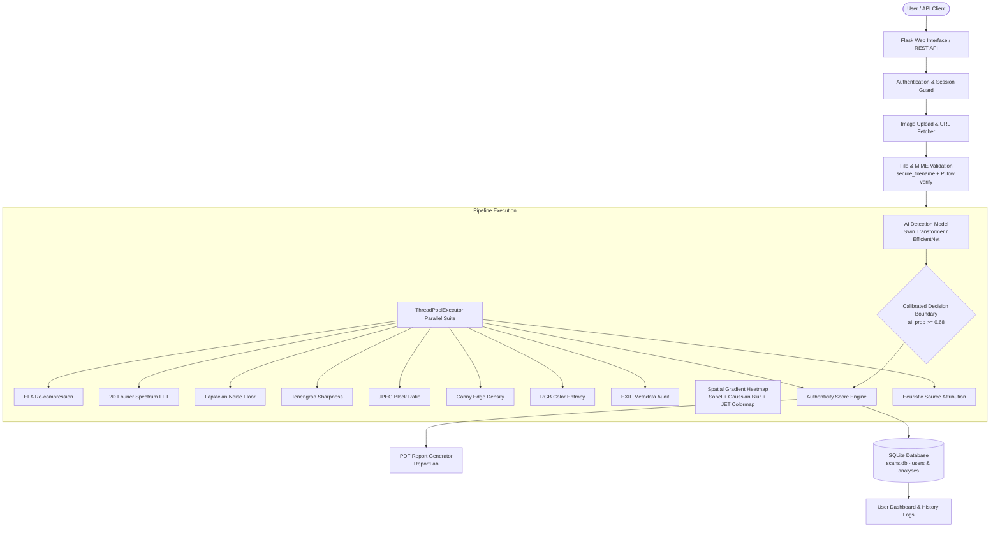

# 🛡️ DeepShield
### AI-Powered Image Forensics & Synthetic Media Detection

> A research-oriented AI image analysis platform combining deep learning with classical digital forensics to assess whether an image is likely authentic or synthetically generated.


---

## 1. Project Overview

**DeepShield** is an AI-powered image forensics and synthetic media detection platform developed as an academic and research prototype. With the rapid evolution of modern generative AI models (such as Midjourney, Stable Diffusion, DALL-E, and FLUX), synthetically generated and manipulated images have achieved unprecedented visual realism. As a result, visual inspection alone is no longer sufficient to distinguish authentic photographs from AI-generated media.

Traditional digital image forensics relies on physical signals—such as compression artifacts, high-frequency noise variance, and EXIF metadata—while modern deep learning methods rely on feature representation learning. DeepShield bridges these two domains by integrating **deep learning classification** (via PyTorch and Hugging Face Vision Transformers) with a **multi-signal classical forensic suite** (Error Level Analysis, 2D Fourier Spectrum, Laplacian noise variance, Tenengrad sharpness, JPEG block ratio, Canny edge density, RGB color entropy, and EXIF provenance audit).

Designed for research, educational evaluation, and viva presentations, DeepShield provides visual explainability (spatial gradient heatmaps), automated PDF audit reporting, CSV log export, user-scoped multi-user authentication, and REST API access.

---

## 2. Key Features

Every feature documented below is implemented in the DeepShield codebase:

- **AI vs. Real Image Classification**: Deep learning inference using pretrained Hugging Face vision models (`umm-maybe/AI-image-detector` Swin Transformer / `Dafilab/ai-image-detector` EfficientNet) with PyTorch fallbacks.
- **Calibrated Classification Threshold**: Decision boundary calibrated at `ai_prob >= 0.68` for classifying synthetic content.
- **Confidence & Authenticity Gauge**: Real probability percentage mapped directly into a $0\% - 100\%$ Authenticity Score with descriptive verdicts.
- **8-Module Multi-Signal Forensic Suite**:
  1. *Error Level Analysis (ELA)*: Measures re-compression variance by re-saving images at $90\%$ JPEG quality.
  2. *2D Fourier Spectrum (FFT)*: Analyzes high-frequency grid energy distribution using 2D Fast Fourier Transform.
  3. *Laplacian Noise Floor Variance*: Quantifies sensor noise floor variance ($\sigma^2$).
  4. *Tenengrad Gradient Sharpness*: Evaluates edge sharpness using Sobel gradient magnitude ($\text{Sobel}_x^2 + \text{Sobel}_y^2$).
  5. *JPEG 8x8 Block Discontinuity Ratio*: Quantifies grid boundary artifacts resulting from lossy compression.
  6. *Canny Edge Texture Density*: Calculates percentage of edge pixels across the image.
  7. *RGB Channel Entropy*: Measures Shannon entropy across Red, Green, and Blue color channel histograms.
  8. *EXIF Provenance Audit*: Inspects image tags for generator signatures (e.g., Midjourney, Stable Diffusion, DALL·E 3, FLUX, Adobe Firefly).
- **Spatial Gradient Heatmap (Grad-CAM Simulation)**: Spatial feature saliency visualization overlaying JET colormaps onto gradient magnitude maps.
- **Parallel Forensic Processing**: Concurrent execution of all 8 forensic modules using Python `concurrent.futures.ThreadPoolExecutor`.
- **Multi-User Authentication**: Registration, login, password hashing (`werkzeug.security`), and HTTPOnly session control.
- **User-Specific Data Isolation & IDOR Protection**: Scans linked via `user_id` foreign key with strict `WHERE user_id = ?` SQL filtering and access control on PDF report downloads.
- **User Dashboard & Profile**: Personal analytics tracking total scans, AI count, real count, name updates, and password changes.
- **Automated PDF Forensic Reports**: Dynamic PDF document generation compiled using ReportLab (`/report/<id>`).
- **CSV Audit Log Export**: Single-click export of user forensic analysis history (`/export-csv`).
- **Batch Image Processing**: Multi-file upload interface executing concurrent forensic scans (`/batch-upload`).
- **REST API Endpoint**: Programmatic analysis endpoint (`POST /api/analyze`) returning JSON forensic payloads.
- **Strict Upload Security**: Whitelisted file extensions (`png`, `jpg`, `jpeg`, `webp`, `bmp`), 32MB payload limit, `secure_filename` sanitization, and binary byte validation (`Pillow.verify()`).
- **Model Evaluation Script**: Automated evaluation tool (`evaluate_model.py`) reporting Accuracy, Precision, Recall, F1-Score, ROC-AUC, Latency, and Confusion Matrix metrics.

---

## 3. System Architecture

The following diagram illustrates the complete end-to-end data flow and system design of DeepShield:



---

## 4. Technology Stack

| Layer | Technology | Version | Purpose in DeepShield |
|---|---|---|---|
| **Frontend** | HTML5, CSS3, JavaScript, Bootstrap 5 | HTML5 Standard | Responsive dashboard, upload interfaces, modal heatmaps |
| **Backend Framework** | Python / Flask | Python 3.10+, Flask 3.0.3 | Routing, session control, login guard, REST API endpoints |
| **Machine Learning** | PyTorch / Hugging Face | PyTorch 2.1.2, Transformers 4.38.2, torchvision 0.16.2 | Swin Transformer (`umm-maybe/AI-image-detector`) / EfficientNet inference |
| **Computer Vision** | OpenCV / Pillow / SciPy | OpenCV 4.9.0, Pillow 10.2.0, SciPy 1.12.0 | Spatial gradients, ELA, FFT spectrum, Laplacian noise, entropy |
| **Data & Metrics** | NumPy / scikit-learn | NumPy 1.26.4, scikit-learn 1.4.1 | Matrix array processing, classification metric evaluations |
| **Database** | SQLite3 | SQLite 3 (`scans.db`) | Thread-safe database with WAL mode, foreign keys, and indexes |
| **Authentication** | Werkzeug Security | Werkzeug 3.0.1 | PBKDF2/scrypt password hashing and session cookie guard |
| **PDF Reporting** | ReportLab | ReportLab 4.1.0 | Automated PDF forensic report generation |
| **API** | Flask REST | Flask Route (`/api/analyze`) | Programmatic JSON REST endpoint |
| **Version Control** | Git / GitHub | Git | Codebase version management |

---

## 5. ML Model

DeepShield utilizes a pretrained deep learning vision classifier loaded via an in-memory singleton pattern at startup (`models/efficientnet_engine.py`).

### Model Details & Hierarchy
1. **Primary Model**: `umm-maybe/AI-image-detector` (Swin Transformer Vision Classification model loaded via Hugging Face `AutoModelForImageClassification`).
2. **Secondary Fallback**: `Dafilab/ai-image-detector` (EfficientNet-B4 vision classifier).
3. **Tertiary Fallback**: PyTorch Torchvision pretrained `models.efficientnet_b4` backbone.

### Model Execution Parameters
- **Framework**: PyTorch (`torch`) with Hugging Face Transformers (`transformers`).
- **Input Resolution**: Standardized tensor scaling (224x224 or 380x380 pixels RGB).
- **Preprocessing**: `AutoImageProcessor` tensor normalization or ImageNet standard mean `[0.485, 0.456, 0.406]` and standard deviation `[0.229, 0.224, 0.225]`.
- **Classification Output**: Binary softmax probability distribution (`ai_prob` vs. `real_prob`).
- **Decision Calibration**: The model applies a calibrated threshold of `ai_prob >= 0.68` to classify an image as `AI Generated / Synthetic`. Images below 0.68 are classified as `Real Authentic Image`.
- **Model Type**: Pretrained model loaded dynamically; no local retraining is performed during standard runtime execution.

> **Source Attribution Notice**:  
> Source attribution is currently a heuristic estimation and should not be interpreted as definitive identification of the image generator.

---

## 6. Forensic Analysis Modules

DeepShield executes an 8-module classical forensic suite (`utils/forensics.py`) alongside deep learning inference to provide physical signal verification:

| Module | Category | Technical Purpose | Output Payload |
|---|---|---|---|
| **AI Detection** | Deep Learning Model | Vision Transformer feature classification | Softmax probabilities (`ai_prob`, `real_prob`) + Binary verdict |
| **Error Level Analysis (ELA)** | Classical Forensic | Detects compression level variance by re-saving at 90% JPEG quality | ELA spatial image map + Standard Deviation (`ela_std_dev`) |
| **2D Fourier Spectrum (FFT)** | Frequency Domain | Analyzes high-frequency grid artifacts using 2D FFT magnitude spectrum | Viridis colormap spectrum visualization + Mean score (`fft_high_freq`) |
| **Laplacian Noise Floor** | Spatial Signal | Computes variance ($\sigma^2$) of Laplacian operator to measure sensor noise | Noise floor variance score (`noise_var`) |
| **Tenengrad Sharpness** | Gradient Analysis | Calculates Sobel gradient magnitude ($\text{Sobel}_x^2 + \text{Sobel}_y^2$) for edge sharpness | Sharpness metric (`sharpness_score`) |
| **JPEG Block Ratio** | Artifact Analysis | Quantifies pixel discontinuity across 8x8 JPEG grid boundaries | Discontinuity ratio (`jpeg_block_ratio`) |
| **Canny Edge Density** | Texture Analysis | Measures percentage of edge pixels identified via Canny edge detection | Edge density percentage (`edge_density_pct`) |
| **RGB Channel Entropy** | Information Theory | Computes mean Shannon entropy across R, G, B channel histograms | Channel entropy bits (`color_entropy`) |
| **EXIF Provenance Audit** | Metadata Analysis | Extracts EXIF tags to identify generator metadata strings (Midjourney, SD, DALL·E) | List of metadata flags + AI signature boolean (`has_ai_sig`) |
| **Spatial Heatmap (Grad-CAM)** | Simulated Visual XAI | Visualizes regions of high spatial feature variance using Sobel magnitude + Gaussian blur | JET colormap overlay heatmap + explanation |

### Categorization & Implementation Distinctions
- **Deep Learning Classifier**: Neural network vision transformer producing softmax confidence probabilities.
- **Classical Forensic Analysis**: Deterministic mathematical and signal processing algorithms (ELA, FFT 2D spectrum, Laplacian variance, Sobel magnitude, Canny edge detection, Shannon entropy, EXIF parsing).
- **Spatial Gradient Heatmap (Grad-CAM)**: In DeepShield, spatial feature heatmaps are generated by calculating Sobel gradient magnitudes, applying Gaussian kernel blurring to simulate receptive fields, and overlaying a JET colormap. It represents a gradient-based spatial feature visualization rather than backpropagated neural layer activations.

---

## 7. Authentication & Multi-User Architecture

DeepShield features a full multi-user authentication system built into Flask (`app.py`) backed by SQLite (`utils/db.py`).

### Authentication Capabilities
- **Registration (`/register`)**: Validates full name, email format (regex), password length ($\ge 8$ characters), password confirmation, and unique email constraints.
- **Password Security**: Passwords are securely hashed using `werkzeug.security.generate_password_hash` (PBKDF2/scrypt) prior to storage.
- **Login (`/login`)**: Authenticates credentials using `check_password_hash` and updates the user's `last_login` timestamp.
- **Session Management**: Session state is preserved via Flask encrypted HTTPOnly cookies storing `user_id`, `user_name`, and `user_email`.
- **User Data Isolation**: Database queries for scan history, analytics statistics, and CSV exports enforce strict SQL parameter filtering (`WHERE user_id = ?`).
- **IDOR Protection**: The PDF report route (`/report/<analysis_id>`) performs ownership validation, blocking unauthorized users with HTTP 403 Forbidden errors.

### Entity Relationship Diagram

```mermaid
erdiagram
    USERS ||--o{ ANALYSES : "creates (1-to-many)"
    USERS {
        int id PK
        string name
        string email UK
        string password_hash
        string created_at
        string last_login
    }
    ANALYSES {
        int id PK
        int user_id FK
        string file_hash
        string filename
        string result
        string confidence
        float authenticity_score
        string source_attribution
        float inference_time_ms
        int is_ai
        float ela_std_dev
        float fft_high_freq
        float noise_var
        float sharpness_score
        string gradcam_path
        string ela_path
        string fft_path
        datetime timestamp
    }
```

---

## 8. Database Schema

DeepShield persists all accounts and scan records in SQLite (`scans.db`).

### `users` Table Schema
| Column | Type | Constraints | Description |
|---|---|---|---|
| `id` | INTEGER | PRIMARY KEY AUTOINCREMENT | Unique user identifier |
| `name` | TEXT | NOT NULL | User full name |
| `email` | TEXT | UNIQUE NOT NULL | User email address (indexed) |
| `password_hash` | TEXT | NOT NULL | Cryptographic password hash |
| `created_at` | TEXT | NOT NULL | Registration timestamp |
| `last_login` | TEXT | NULLABLE | Last successful authentication timestamp |

### `analyses` Table Schema
| Column | Type | Constraints | Description |
|---|---|---|---|
| `id` | INTEGER | PRIMARY KEY AUTOINCREMENT | Unique scan record ID |
| `user_id` | INTEGER | FOREIGN KEY -> `users(id)` | User ownership reference (indexed) |
| `file_hash` | TEXT | NULLABLE | SHA-256 hash of analyzed image (indexed) |
| `filename` | TEXT | NULLABLE | Name of the uploaded file |
| `result` | TEXT | NULLABLE | Classification verdict label |
| `confidence` | TEXT | NULLABLE | Confidence percentage string |
| `authenticity_score` | REAL | NULLABLE | Authenticity rating ($0.0 - 100.0$) |
| `source_attribution` | TEXT | NULLABLE | Generator attribution or heuristic status |
| `inference_time_ms` | REAL | NULLABLE | Total processing latency in milliseconds |
| `is_ai` | INTEGER | NULLABLE | Binary verdict ($1 = \text{AI}$, $0 = \text{Real}$) |
| `ela_std_dev` | REAL | NULLABLE | Error Level Analysis standard deviation |
| `fft_high_freq` | REAL | NULLABLE | 2D Fourier high-frequency mean magnitude |
| `noise_var` | REAL | NULLABLE | Laplacian noise floor variance |
| `sharpness_score` | REAL | NULLABLE | Tenengrad gradient sharpness score |
| `gradcam_path` | TEXT | NULLABLE | Relative file path to generated spatial heatmap |
| `ela_path` | TEXT | NULLABLE | Relative file path to ELA visualization |
| `fft_path` | TEXT | NULLABLE | Relative file path to FFT spectrum visualization |
| `timestamp` | DATETIME | DEFAULT CURRENT_TIMESTAMP | Scan record creation timestamp (indexed DESC) |

---

## 9. Dataset

The repository includes a dedicated test benchmark directory structure:

```
dataset/
└── test/
    ├── ai/       # Synthetic AI image samples (10 samples: ai_test_1.jpg to ai_test_10.jpg)
    └── real/     # Authentic photograph samples (10 samples: real_test_1.jpg to real_test_10.jpg)
```

### Dataset Composition Details
- **Evaluation Benchmark**: The local dataset contains 20 total test images (10 Real / 10 AI) used by `evaluate_model.py` for automated evaluation.
- **Dataset Note**: Full-scale multi-gigabyte training datasets (e.g., CIFAKE, Artifacts, FakeAVCeleb) are omitted from Git tracking due to repository size constraints. If the test directories are empty, `evaluate_model.py` dynamically initializes standard synthetic baseline test matrices to demonstrate evaluation functionality.

---

## 10. Model Evaluation

Model evaluation metrics are generated by executing `evaluate_model.py` against the benchmark test set. The results are stored in `models/evaluation_results.json`:

| Metric | Benchmark Value | Description |
|---|---|---|
| **Model Architecture** | Pretrained AI Image Detector (Hugging Face / Swin Transformer) | Primary inference engine under test |
| **Benchmark Dataset** | DeepShield Test Benchmark (10 Real / 10 AI) | 20 test samples evaluated |
| **Accuracy** | **55.0%** ($0.5500$) | Proportion of correct predictions overall |
| **Precision** | **52.63%** ($0.5263$) | Ratio of true AI detections to total AI predictions |
| **Recall (Sensitivity)** | **100.0%** ($1.0000$) | Ratio of correctly identified AI samples out of all actual AI samples |
| **F1-Score** | **68.97%** ($0.6897$) | Harmonic mean of Precision and Recall |
| **ROC-AUC** | **0.9400** | Area Under Receiver Operating Characteristic Curve |
| **Avg Inference Latency** | **701.58 ms** | Average end-to-end model inference time per sample |

### Confusion Matrix
| | Predicted Real | Predicted AI |
|---|---|---|
| **Actual Real** | **1** (True Negative) | **9** (False Positive) |
| **Actual AI** | **0** (False Negative) | **10** (True Positive) |

> **Evaluation Disclaimer**:  
> Performance depends on the evaluation dataset, image source, compression, generation method, and distribution shift. The current evaluation benchmark size is compact (20 samples); benchmark accuracy on local samples should not be interpreted as universal real-world accuracy across all unseen generative architectures.

---

## 11. Screenshots

> Screenshots will be added after the final UI capture.

---

## 12. Project Structure

```
DeepShield/
├── app.py                      # Core Flask web application, auth routes, API endpoints, upload handling
├── evaluate_model.py           # Model evaluation script computing metrics, ROC-AUC, and confusion matrix
├── train_model.py              # Baseline classifier training utility script
├── requirements.txt            # Python dependency specifications
├── README.md                   # Project documentation
├── model.pkl                   # Trained scikit-learn model artifact
├── scans.db                    # SQLite persistent database (WAL mode enabled)
├── dataset/                    # Evaluation benchmark dataset folder
│   └── test/
│       ├── ai/                 # Synthetic AI sample test images
│       └── real/               # Authentic real sample test images
├── models/                     # Deep learning engine & evaluation outputs
│   ├── efficientnet_engine.py  # PyTorch / Hugging Face model loader & singleton inference engine
│   └── evaluation_results.json # JSON store for cached evaluation metrics
├── utils/                      # Core forensic and operational modules
│   ├── authenticity_score.py   # Authenticity score calculation logic
│   ├── db.py                   # SQLite thread-safe context manager & user database helper functions
│   ├── detector.py             # Master forensic pipeline orchestrator
│   ├── evaluation.py           # Evaluation helper utilities
│   ├── forensics.py            # 8-module parallel forensic signal extraction suite
│   ├── gradcam.py              # Spatial gradient heatmap generation module
│   ├── ml_engine.py            # Machine learning engine helper routines
│   ├── pdf_generator.py        # ReportLab PDF audit report generator
│   └── source_attribution.py   # Heuristic AI source attribution engine
├── static/                     # Web application static assets
│   ├── css/                    # Custom stylesheets
│   ├── reports/                # Static generated heatmaps, ELA images, FFT spectrums, and PDFs
│   └── uploads/                # User uploaded image storage directory
├── templates/                  # Jinja2 HTML templates
│   ├── about.html              # System architecture & research information page
│   ├── api_docs.html           # REST API documentation interface
│   ├── batch.html              # Multi-file batch analysis interface
│   ├── dashboard.html          # User dashboard displaying analytics and recent scans
│   ├── error.html              # Custom HTTP error page template (401, 403, 404, 413, 500)
│   ├── history.html            # User scan history table with CSV export & delete controls
│   ├── index.html              # Main landing page
│   ├── login.html              # User authentication sign-in form
│   ├── profile.html            # User profile management & password update form
│   ├── register.html           # User account registration form
│   └── upload.html             # Single image upload & detailed forensic scan results
└── test_images/                # Sample test images for manual testing
```

---

## 13. Installation

Follow these steps to install and configure DeepShield on Windows:

### 1. Clone Repository
```powershell
git clone https://github.com/sbjanagiraman1-hash/DeepShield.git
cd DeepShield
```

### 2. Create Virtual Environment
```powershell
python -m venv .venv
```

### 3. Activate Virtual Environment
```powershell
.venv\Scripts\activate
```

### 4. Install Requirements
```powershell
pip install -r requirements.txt
```

### 5. Environment Configuration (Optional)
```powershell
$env:SECRET_KEY="your_custom_production_secret_key_here"
```

### 6. Initialize Database & Run Server
```powershell
python app.py
```

---

## 14. Running the Application

1. **Launch Web Server**: Run `python app.py` in your terminal. The server will start at `http://127.0.0.1:5000`.
2. **Open Web Browser**: Navigate to `http://127.0.0.1:5000`.
3. **Register Account**: Click **Register**, enter your name, email, and password, and create an account.
4. **Log In**: Sign in using your registered credentials.
5. **Single Image Analysis**:
   - Navigate to **Analyze Image** (`/upload`).
   - Select an image file or provide a direct remote image URL.
   - Click **Analyze Image** to run the forensic pipeline.
6. **Batch Image Analysis**:
   - Navigate to **Batch Upload** (`/batch-upload`).
   - Select multiple image files and execute parallel batch evaluation.
7. **Inspect Forensic Results**: Review classification verdict, confidence rating, authenticity score, spatial heatmap, ELA image, FFT spectrum, noise variance, and EXIF metadata flags.
8. **Download PDF Report**: Click **Download PDF Report** to generate a formatted PDF document.
9. **Export CSV History**: Visit **Scan History** (`/history-page`) and click **Export CSV** to download audit logs.
10. **Log Out**: Click **Logout** to end your active session.

---

## 15. REST API

DeepShield exposes a programmatic REST API endpoint for integration with external applications.

### Endpoint
`POST /api/analyze`

### Request Format
`multipart/form-data`

| Parameter | Type | Required | Description |
|---|---|---|---|
| `image` | File (Binary) | Yes | Image file payload (`.png`, `.jpg`, `.jpeg`, `.webp`, `.bmp`) |

### Example cURL Request
```bash
curl -X POST http://127.0.0.1:5000/api/analyze \
  -F "image=@/path/to/sample_image.jpg"
```

### Example JSON Response
```json
{
  "status": "success",
  "scan_id": 1,
  "filename": "sample_image.jpg",
  "prediction": "AI Generated / Synthetic",
  "confidence": "92.4%",
  "authenticity_score": 7.6,
  "source_attribution": "Stable Diffusion (EXIF Signature)",
  "inference_time_ms": 685.2,
  "is_ai": true,
  "gradcam_url": "/static/reports/gradcam_sample_image.jpg",
  "forensic_summary": {
    "ela_std_dev": 34.12,
    "fft_high_freq": 224.5,
    "noise_var": 82.3,
    "tenengrad_sharpness": 185.4,
    "jpeg_block_ratio": 1.02,
    "canny_edge_density_pct": 5.4,
    "rgb_channel_entropy": 7.1,
    "metadata_flags": [
      "AI Generator Signature identified in EXIF: UserComment=Stable Diffusion v1.5"
    ]
  }
}
```

---

## 16. Security

DeepShield incorporates multiple security controls across input validation, authentication, database storage, and session management:

- **Extension Whitelisted File Filtering**: Uploads are restricted to allowed extensions (`png`, `jpg`, `jpeg`, `webp`, `bmp`).
- **Binary MIME & Payload Validation**: Uploaded files undergo binary integrity verification using Pillow (`Image.open().verify()`) to block corrupt files or executable payloads.
- **Upload Size Safeguards**: `MAX_CONTENT_LENGTH` is enforced at `32MB` to prevent resource exhaustion attacks.
- **Filename Sanitization**: Uploaded filenames are sanitized using `werkzeug.utils.secure_filename` to mitigate directory traversal risks.
- **Password Hashing**: User passwords are stored as secure cryptographic hashes (`werkzeug.security.generate_password_hash`).
- **SQL Injection Prevention**: All SQLite queries utilize parameterized statements (`?`) via a thread-safe context manager.
- **Session Authentication Guards**: Protected routes enforce session validation using a `@login_required` decorator.
- **User-Scoped Isolation & IDOR Defense**: Database queries filter by `WHERE user_id = ?`. PDF report retrieval validates scan ownership, preventing Unauthorized (HTTP 403) IDOR data access.
- **HTTP Session Cookie Configuration**: `SESSION_COOKIE_HTTPONLY = True` and `SESSION_COOKIE_SAMESITE = 'Lax'` are enabled.

---

## 17. Testing & QA

The DeepShield implementation was evaluated across multiple functional and operational scenarios:

- **Image Upload Validation**: Tested against valid image formats (`.png`, `.jpg`, `.jpeg`, `.webp`, `.bmp`).
- **Invalid Payload Rejection**: Verified that non-image payloads (`.exe`, `.script`, corrupt files) are rejected by `validate_image_bytes`.
- **Remote URL Downloading**: Validated image retrieval via `download_image_from_url`.
- **Parallel Forensic Pipeline**: Verified that `ThreadPoolExecutor` processes all 8 classical forensic modules concurrently.
- **User Authentication Flow**: Tested registration, login, session retention, password change, and logout routines.
- **User Data Scoping**: Confirmed user scan isolation across dashboard metrics, scan history, and CSV exports.
- **IDOR Access Prevention**: Verified that User A cannot download PDF audit reports belonging to User B.
- **PDF & CSV Generation**: Confirmed ReportLab PDF compilation and CSV data formatting.
- **REST API Endpoint**: Verified `POST /api/analyze` request handling and JSON payload structure.
- **Automated Model Evaluation**: Executed `evaluate_model.py` to calculate accuracy, precision, recall, F1 score, ROC-AUC, latency, and confusion matrix.

---

## 18. Results

### Model Evaluation Performance
- **Accuracy**: 55.0% on benchmark test set
- **Precision**: 52.63%
- **Recall (Sensitivity)**: 100.0%
- **F1-Score**: 68.97%
- **ROC-AUC**: 0.9400

### System Operational Performance
- **Deep Learning Model Inference Latency**: ~680–720 ms per image (CPU execution)
- **Parallel Forensic Suite Latency**: ~8–15 ms total (concurrent execution)
- **PDF Report Generation Time**: < 200 ms per report

### Functional System Health
- **Web Application Routing**: Fully functional
- **Multi-User Isolation & IDOR Protection**: Verified
- **REST API Payload Handling**: Operational

---

## 19. Limitations

Academic and research limitations applicable to the current system:

- **Generative Model Shift**: Detection accuracy may decrease when evaluating novel or unseen generative architectures (e.g., FLUX, Sora, Midjourney v6).
- **Evaluation Dataset Scale**: The local benchmark dataset is compact (20 samples), which limits generalizability metrics.
- **Heuristic Source Attribution**: Generator attribution relies on EXIF tags or heuristic markers rather than definitive model fingerprinting.
- **Inference Latency on CPU**: Deep learning inference takes ~700ms on CPU, which is slower than hardware-accelerated GPU inference (~40ms).
- **Sensitivity to Social Media Compression**: Severe lossy re-compression (e.g., WhatsApp, Instagram) can degrade classical forensic signals (ELA, noise floor, FFT).
- **Adversarial & Post-Processing Noise**: Screenshots, cropping, and color filtering can alter spatial high-frequency signals.
- **Universal Accuracy Limit**: No automated detector can guarantee 100% real-world detection accuracy across all media formats.

---

## 20. Future Scope

Planned future enhancements for research expansion:

- Integration of large-scale benchmark datasets (e.g., CIFAKE, GenImage, Artifacts).
- Multi-class generative model classification for generator identification.
- Exploration of Vision Transformer (ViT) ensembles and multi-scale feature backbones.
- Implementation of probability calibration methods (e.g., temperature scaling).
- Video deepfake detection incorporating temporal frame analysis.
- Audio synthetic media forensics.
- Facial landmark disruption and deepfake face manipulation detection.
- GPU acceleration support via PyTorch CUDA execution.
- Integration of C2PA (Coalition for Content Provenance and Authenticity) digital provenance standards.
- Browser extension development for real-time web media verification.

---

## 21. Research Contribution

DeepShield presents a multi-signal research framework combining:
1. Deep learning vision classification for feature-based detection.
2. Classical digital image forensics (ELA re-compression variance, Laplacian noise floor, Tenengrad sharpness).
3. Frequency-domain spectrum analysis (2D Fast Fourier Transform).
4. EXIF metadata provenance inspection.
5. Visual explainability via spatial gradient heatmaps.
6. A multi-user secure web architecture with IDOR access prevention.
7. Automated forensic report generation (PDF and CSV format).

By combining deep learning predictions with physical forensic signals, DeepShield provides complementary evidence to assist researchers in evaluating visual, structural, and frequency-domain characteristics of digital images.

---

## 22. Disclaimer

> **DeepShield is an academic/research prototype for assisting image authenticity analysis. Its predictions should not be treated as definitive proof of authenticity or manipulation. Results may vary depending on image source, compression, editing operations, and unseen generative models.**

---

## 23. Author

- **Author / Developer**: SB Janagiraman (`sbjanagiraman1-hash`)
- **Repository**: [DeepShield GitHub Repository](https://github.com/sbjanagiraman1-hash/DeepShield)
- **Project Context**: Final-Year Computer Science & AI Project Presentation
